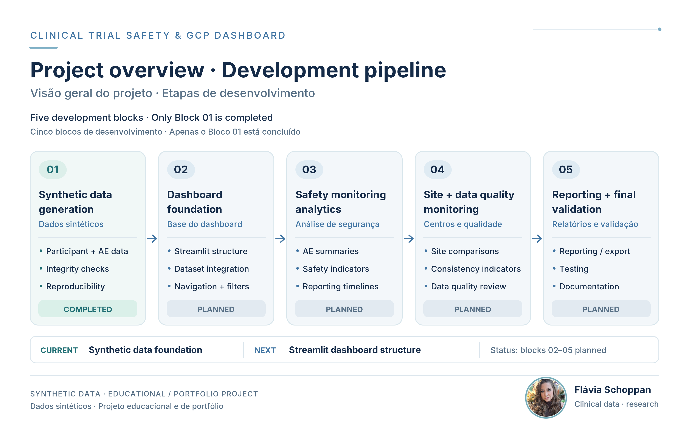
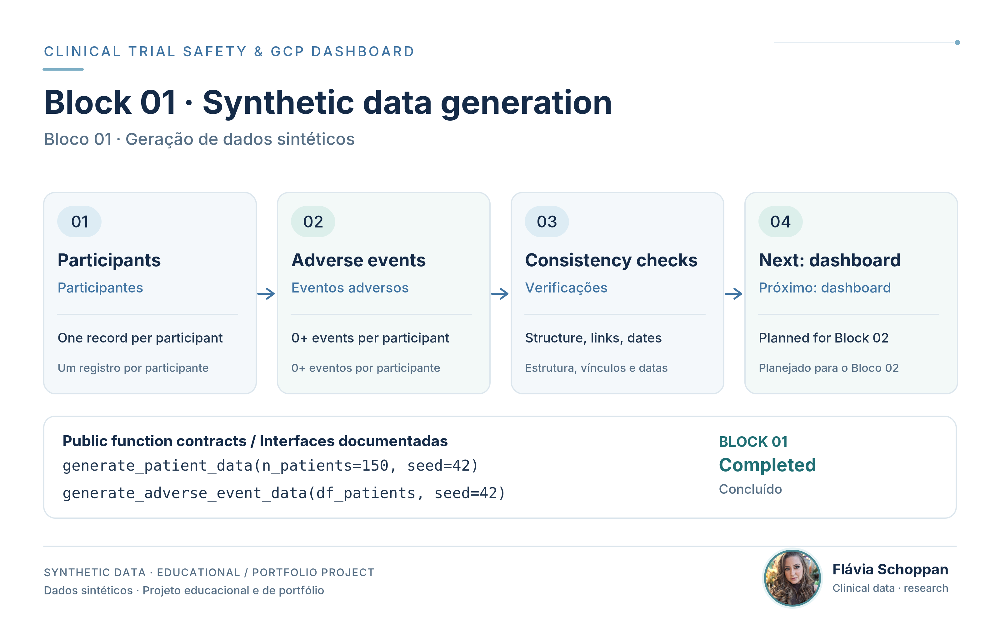
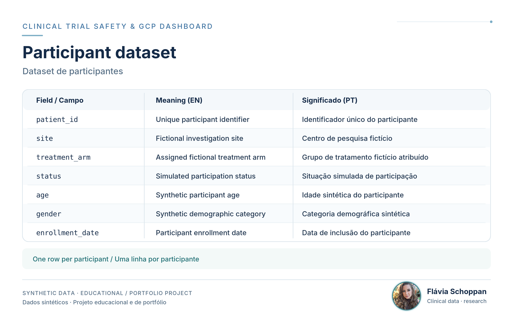
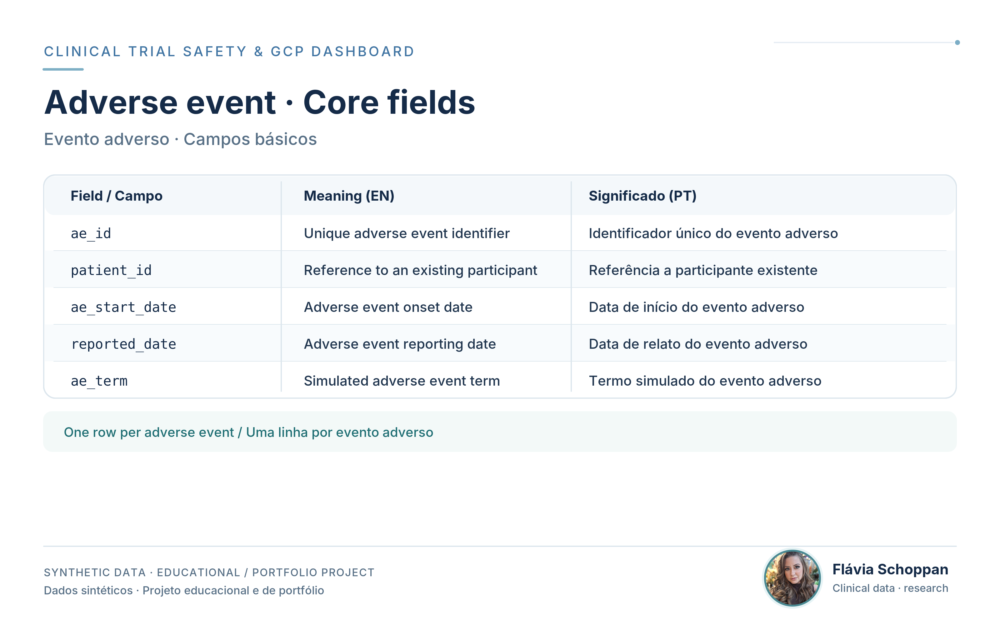
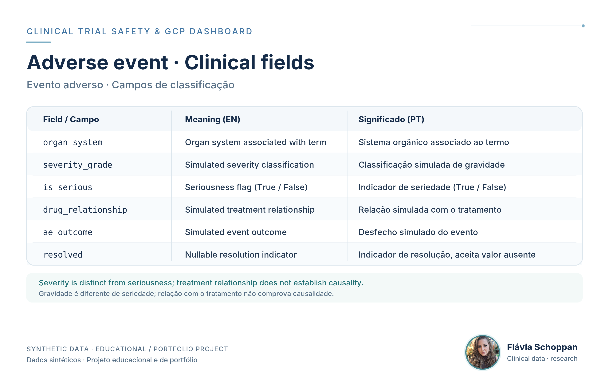
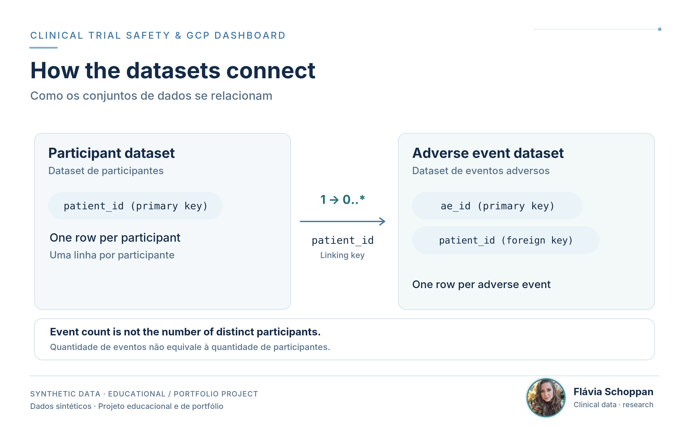
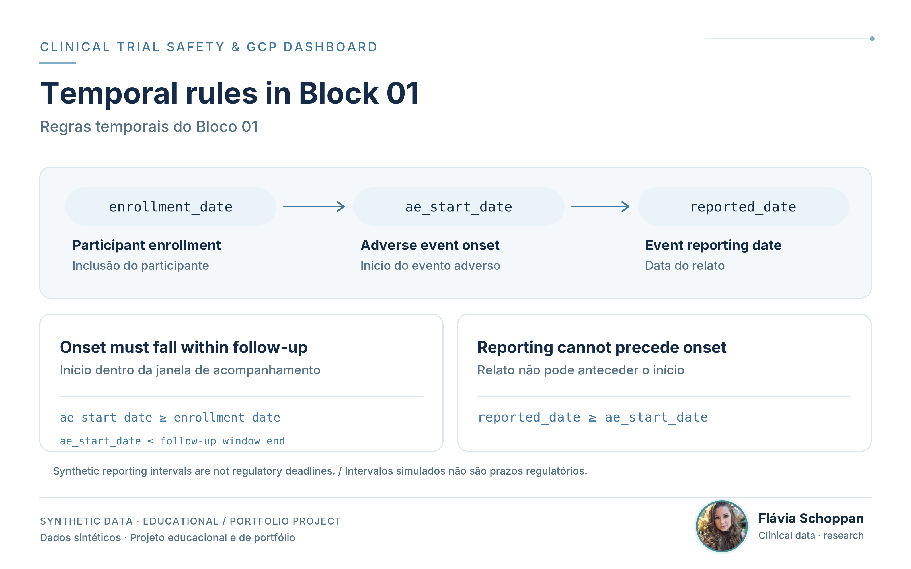
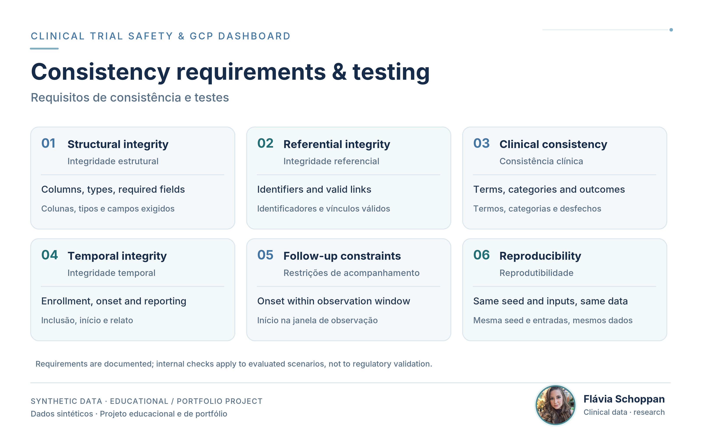
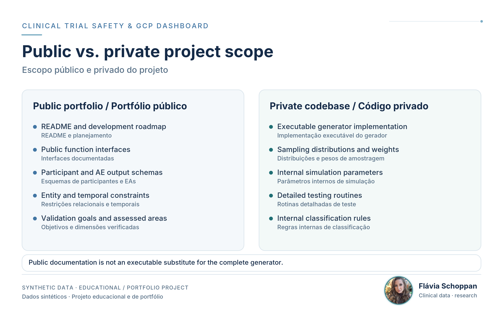

# Clinical Trial Safety & GCP Dashboard

**Python | Clinical Trial Data | Safety Monitoring | Good Clinical Practice (GCP)**

A Python-based project under development to simulate clinical trial data and build an interactive dashboard for exploring adverse event reporting, participant safety, site-level monitoring, and data quality within the context of Good Clinical Practice (GCP).

The project aims to combine synthetic clinical trial data generation, structured data validation, and interactive visualizations to demonstrate practical applications of programming and data analytics in clinical research.

**Development status:** Block 01 completed; dashboard development pending.

All datasets will be entirely synthetic and represent a fictional clinical trial. This project is intended for educational, technical development, and portfolio purposes. It will not use real patient information or serve as a clinically or regulatorily validated monitoring system.

## 1. Project objectives

The project aims to develop a reproducible analytical environment for exploring selected aspects of clinical trial data management and safety monitoring.

Its main objectives are to:

- Generate structured synthetic participant and adverse event datasets.
- Model relationships between participants, study sites, treatment groups, and adverse event records.
- Apply data integrity and consistency checks to simulated clinical data.
- Explore adverse event characteristics, classifications, and reporting timelines.
- Develop interactive visualizations for safety-related data exploration.
- Investigate site-level indicators and potential data quality issues.
- Demonstrate reproducible Python workflows relevant to clinical research and GCP-oriented data review.

The project is designed as a technical demonstration rather than a substitute for clinical monitoring procedures, pharmacovigilance systems, or regulatory safety reporting.

## 2. Development roadmap

The project will be developed incrementally, beginning with the synthetic data foundation.

| Development block                                   | Scope                                                                                          | Status    |
| --------------------------------------------------- | ---------------------------------------------------------------------------------------------- | --------- |
| **Block 01** - **Synthetic Data Generation**        | Participant and adverse event data modeling, generation, integrity checks, and reproducibility | Completed |
| **Block 02** - **Dashboard Foundation**             | Streamlit application structure, dataset integration, navigation, and interactive filters      | Planned   |
| **Block 03** - **Safety Monitoring Analytics**      | Adverse event summaries, safety indicators, and interactive visualizations                     | Planned   |
| **Block 04** - **Site and Data Quality Monitoring** | Site-level comparisons, consistency indicators, and exploratory data quality assessments       | Planned   |
| **Block 05** - **Reporting and Final Validation**   | Data exploration refinements, reporting/export features, testing, and documentation            | Planned   |

The roadmap represents the intended development direction and may be refined as the project progresses. Planned functionality should not be interpreted as already implemented.

### Block 01 — Visual overview

The first development block establishes the structured synthetic data foundation for subsequent analytical development. The diagram summarizes the two related datasets and their documented consistency requirements; it does not represent a completed dashboard.

## 3. Block 01 — Data model and consistency

The public documentation describes the expected structure and relationships of the synthetic datasets. The executable generator and detailed internal verification procedures are maintained separately.

### 3.1 Participant dataset

The participant generator defines a `pandas.DataFrame` with one record per synthetic participant. The documented fields are `patient_id`, `site`, `treatment_arm`, `status`, `age`, `gender`, and `enrollment_date`. Each `patient_id` is unique and identifies a fictional participant, not a real person.

### 3.2 Adverse event dataset

The adverse event generator defines a second `pandas.DataFrame` in which each row represents one synthetic adverse event. The unique event identifier is `ae_id`, while `patient_id` links the event to an existing participant. A participant may have zero, one, or multiple events.

### 3.3 Clinical classification fields

Event records include simulated terminology, organ system, severity, seriousness, treatment relationship, outcome, and resolution status. `severity_grade` and `is_serious` represent different concepts. `drug_relationship` is a synthetic classification, not evidence of a causal association with treatment. The `resolved` field can represent missing information where applicable.

### 3.4 Dataset relationships

The shared `patient_id` establishes a one-to-many relationship between participant records and adverse event records. Every generated event must refer to an existing participant. The total number of adverse event records must not be interpreted as the number of distinct participants experiencing events.

### 3.5 Temporal consistency

For each synthetic adverse event, `ae_start_date` must be on or after the corresponding participant's `enrollment_date` and within the configured follow-up window. `reported_date` must be on or after `ae_start_date`; reporting can occur after the follow-up window. These simulated intervals do not represent regulatory reporting deadlines.

### 3.6 Consistency and reproducibility

The public specification documents structural, referential, clinical, temporal, follow-up, and reproducibility requirements. These include consistent column definitions and data types, valid identifiers and relationships, internally coherent event attributes, and deterministic generation under an identical configuration and random seed. Internal checks are distinct from the generator's output and do not constitute clinical or regulatory validation.

## 4. Public repository scope

This repository is the **public portfolio edition** of the Clinical Trial Safety & GCP Dashboard project.

It will provide selected technical documentation, development milestones, project structure, and non-proprietary materials intended to demonstrate the project's design, methodology, and development progress.

The public specification is documented in `src/data/generator.py`, covering the `generate_patient_data(n_patients=150, seed=42)` and `generate_adverse_event_data(df_patients, seed=42)` interfaces. It defines the expected inputs and outputs, participant and adverse event data schemas, entity relationships, clinical classification and temporal constraints, and structural, referential, clinical, temporal, and reproducibility validation requirements without exposing the executable implementations.

The Block 01 public specification also documents the scope of internal consistency checks and the boundaries between publicly available technical documentation and privately maintained executable code. Internal consistency checks do not constitute clinical or regulatory validation.

The complete executable implementation, internal simulation logic, configuration parameters, and detailed validation routines will be maintained separately in a private codebase.

Accordingly, the public repository is not intended to provide a fully executable or reproducible version of the complete application.

## 5. Technology stack

| Technology       | Intended application                                                     |
| ---------------- | ------------------------------------------------------------------------ |
| **Python**       | Data generation, processing, validation, and application logic           |
| **pandas**       | Structured clinical trial data modeling and manipulation                 |
| **NumPy**        | Controlled synthetic data generation and reproducibility                 |
| **Streamlit**    | Planned interactive dashboard interface                                  |
| **Plotly**       | Planned interactive data visualizations                                  |
| **Git / GitHub** | Version control, development history, and public technical documentation |

## 6. GCP and Clinical research context

Good Clinical Practice provides an ethical and quality framework for the design, conduct, recording, and reporting of clinical trials.

Within this context, reliable data structures, traceability, consistency, and accurate safety information are relevant to clinical research workflows.

This project will explore selected technical concepts related to these areas through simulated clinical trial data and reproducible analytical workflows.

The dashboard is not designed to establish GCP compliance, replace investigator or sponsor responsibilities, or perform validated regulatory safety reporting.

## 7. Data privacy and project limitations

The project will use fictional study sites, participants, treatment groups, and adverse event records.

It is intended for software development, methodological exploration, and demonstration of technical skills. It will not use identifiable patient information, represent an actual clinical trial, estimate real treatment effects, or provide clinical decision support.

## 8. Current development status

**Overall project:** In development.

**Current milestone:** Block 01 (Synthetic Data Generation) - Completed, with the public technical specification documenting participant and adverse event data models, clinical and temporal constraints, validation requirements, and implementation boundaries.

**Next development step:** Begin Block 02 by defining the Streamlit dashboard structure, dataset integration, navigation, and interactive filtering.

This README will be updated as additional development milestones are completed.